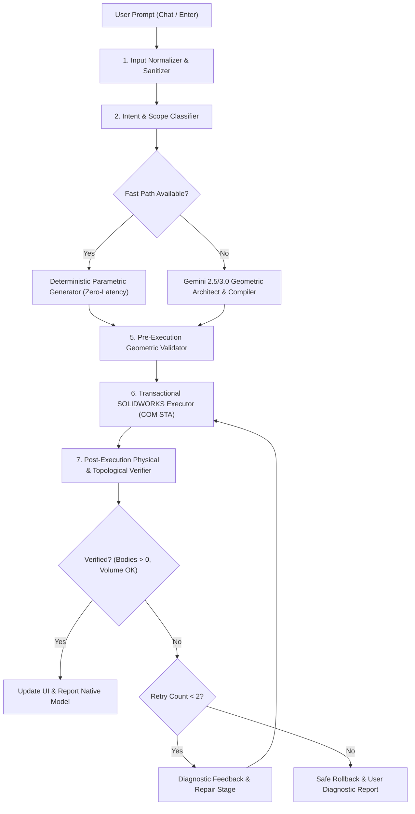

# AI CAD Assistant v3.0 — Architecture Research & Synthesis

## Executive Summary
This document synthesizes architectural best practices from leading computational CAD frameworks (Adze, SolidWorks-MCP-Server, Multi-Agent-CAD, and CadQuery/build123d) into a robust, high-performance architecture for **AI CAD Assistant v3.0** running natively in SOLIDWORKS 2025 SP1.1 via COM Interop and powered by the Google Gemini API.

---

## 1. Comparative Architectural Analysis

| Dimension | Adze (Anthropomorphic/Tool-Centric) | SolidWorks-MCP-Server | Multi-Agent CAD (MIT/DeepMind) | CadQuery / build123d | AI CAD Assistant v3.0 Adaptation |
| :--- | :--- | :--- | :--- | :--- | :--- |
| **Tool Granularity** | Typed Read/Write tools with strict parameter schemas | Procedural tool calls over stdio/JSON-RPC | Multi-stage pipeline with specialized agent roles | Functional / programmatic fluent API | **Typed CAD Tool Registry** (`ICadTool`) with strict pre/post-conditions & typed metadata |
| **Sketch Model** | Point/Line sequences | Chained segments (`sketch_profile`) with arc centers | Geometric constraints & symbolic solver | Workplanes, local 2D coordinates, chained profiles | **Deterministic Sketch Lifecycle Manager** (7-phase state machine with local-to-global transform) |
| **Entity Referencing**| UI path & named bodies | String-based names or direct pointers | Semantic graph dependencies | Topological selectors (`>Z`, `|X`, etc.) | **Hybrid Persistent References** (`GetPersistReference3` + semantic face/edge selectors) |
| **Verification** | Visual grounding / diff checks | Mass properties query (`swMassProperties`) | QA Judge with self-correction prompt | Kernel-level BREP validation | **Multi-tier Physical & Topological Verifier** (Bodies > 0, Volume Delta, Bounds, Rebuild errors) |
| **Execution Loop** | Interactive prompt-response | RPC command execution | Generate -> Execute -> Diagnose -> Repair | Python script compilation | **Direct Chat-to-CAD Execution** with automatic 2-stage repair loop |

---

## 2. Key Architectural Insights & Adaptations for v3.0

### 2.1 The Sketch Lifecycle State Machine
A primary failure mode in previous versions was the desynchronization between SOLIDWORKS sketch state and feature invocation (e.g., "Gagal melakukan Extrude Cut. Pastikan terdapat sketsa tertutup aktif").
In SOLIDWORKS COM Interop, sketch operations behave as stateful transactions:
1. `Idle`: Selection cleared, document ready.
2. `SketchStarted`: `InsertSketch2(true)` called on resolved plane/face.
3. `GeometryCreated`: Lines, arcs, circles, rectangles drawn with internal meters conversion.
4. `GeometryValidated`: Bounding box, closure check, non-zero area.
5. `SketchClosed`: `InsertSketch2(true)` toggled to exit edit mode (or left open strictly if feature consumes active sketch).
6. `ProfileSelected`: Explicit `SelectByID2` on the specific sketch feature name with mark `0`.
7. `FeatureExecuted`: Invocation of `FeatureCut4`, `FeatureExtrude3`, or `FeatureRevolve2`.

### 2.2 Workplane & Face-Local Coordinate Transformation
When placing features (holes, bosses, cuts) on existing faces:
- Planar faces have local 2D axes $(u, v)$ oriented according to the face normal $\vec{n}$.
- AI CAD Assistant v3.0 introduces `CoordinateTransformer` to project $(u, v)$ coordinates into model-space $(x, y, z)$ coordinates using face centroid, normal, and tangent vectors.
- This eliminates misalignment when adding rods, holes, or bosses to arbitrary faces.

### 2.3 Semantic Face & Edge Selectors (CadQuery Pattern)
Instead of relying on unstable internal entity names (`Face1`, `Edge42`), v3.0 introduces semantic selectors:
- `TopPlanarFace`: Face with normal parallel to $+Z$ (or $+Y$).
- `BottomPlanarFace`: Face with normal parallel to $-Z$.
- `LargestPlanarFace`: Face with maximum planar surface area.
- `CircularEdgesOnFace`: Edges belonging to a specific face that are circular.
- `BoundingBoxCenter`: Centroid of the entire solid body or selected face.

### 2.4 Mass Properties as Ground Truth
SOLIDWORKS `IModelDocExtension.CreateMassProperty()` provides deterministic verification:
- Total solid body count ($N > 0$).
- Volume $V$ in $\text{m}^3$ (converted to $\text{mm}^3$).
- Surface area, Center of Mass, Moments of Inertia.
- If $N == 0$ or $V \le 0$, the operation is immediately flagged as `FAILED` and rolled back or repaired.

### 2.5 Multi-Stage Pipeline Architecture


---

## 3. SOLIDWORKS COM Interop Specifics

### 3.1 Silent Mode & Dialog Suppression
To prevent blocking popups during automation:
```csharp
swApp.SetUserPreferenceToggle((int)swUserPreferenceToggle_e.swSilentMode, true);
```
Errors are captured programmatically via `IFeature.GetErrorCode2()` and `IModelDoc2.GetRebuildError()`.

### 3.2 Threading Discipline
- All SOLIDWORKS COM calls must occur on an STA thread or the main UI dispatcher when interacting with the Task Pane.
- Long-running AI calls (Gemini API HTTP requests) must run asynchronously (`Task.Run` / `HttpClient.SendAsync`) without blocking the SOLIDWORKS UI message pump.

---

## 4. Conclusion
Adopting these proven patterns guarantees high reliability, sub-second latency for standard engineering components, deterministic sketch lifecycle management, and verified physical outputs in SOLIDWORKS 2025.

